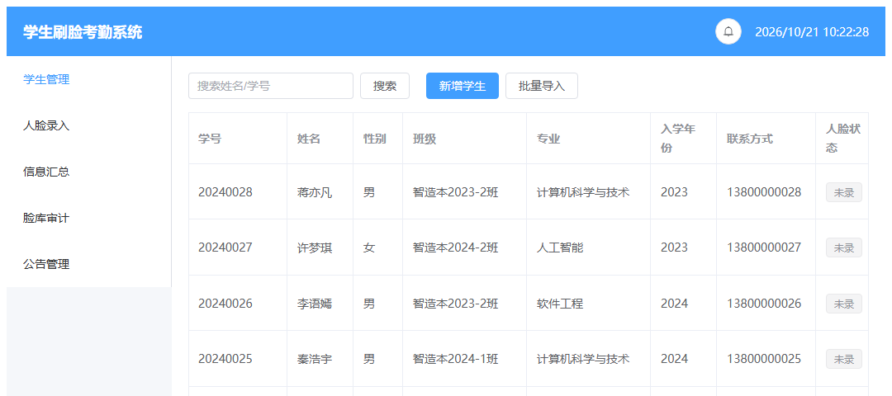
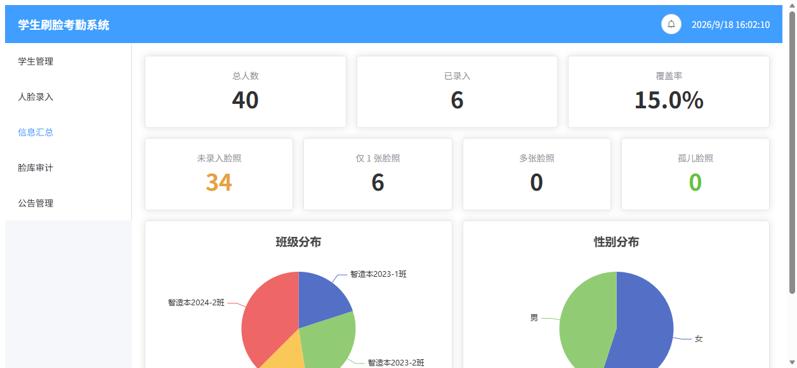
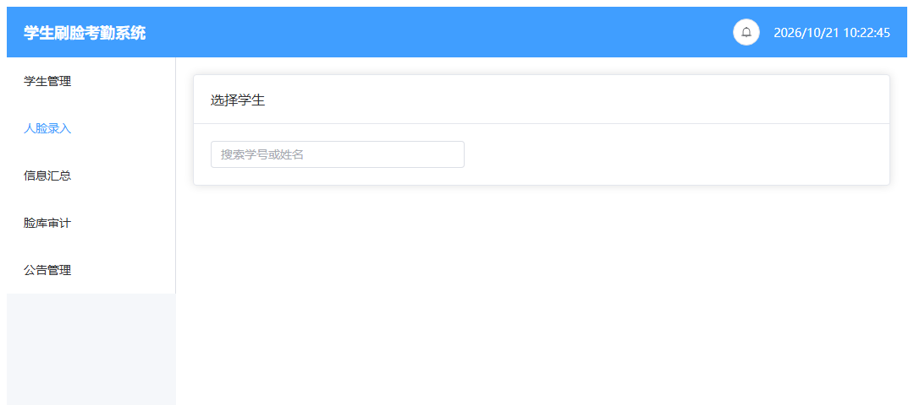
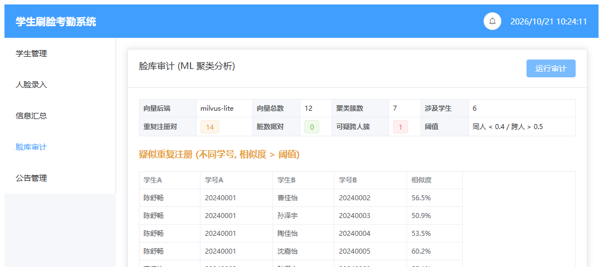
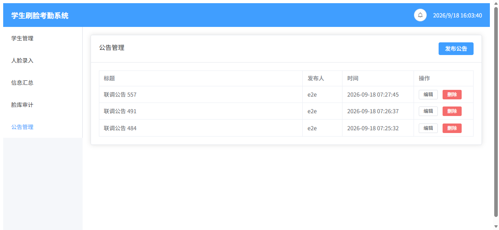
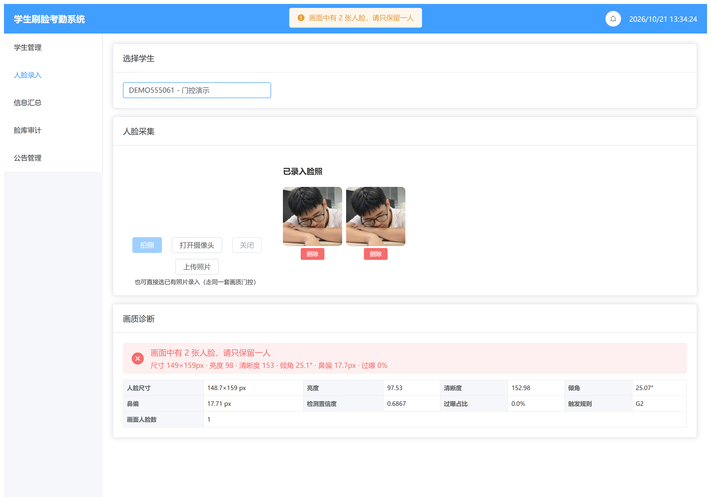
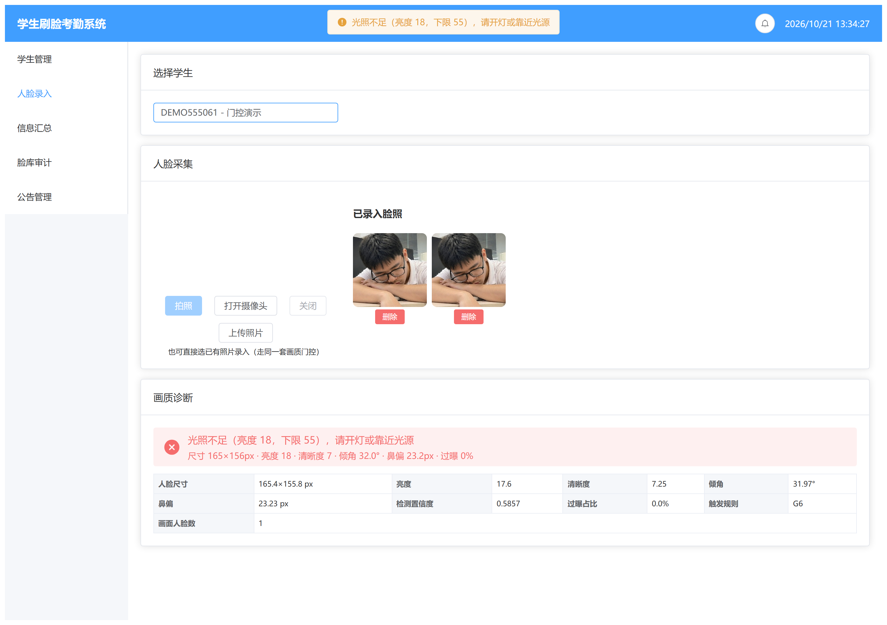
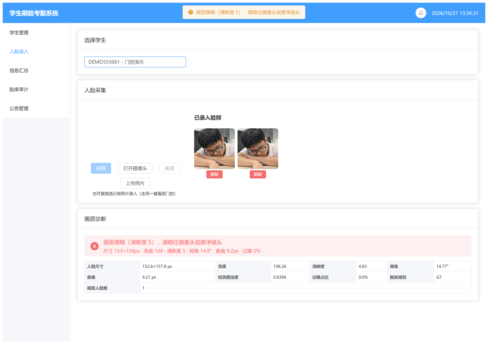
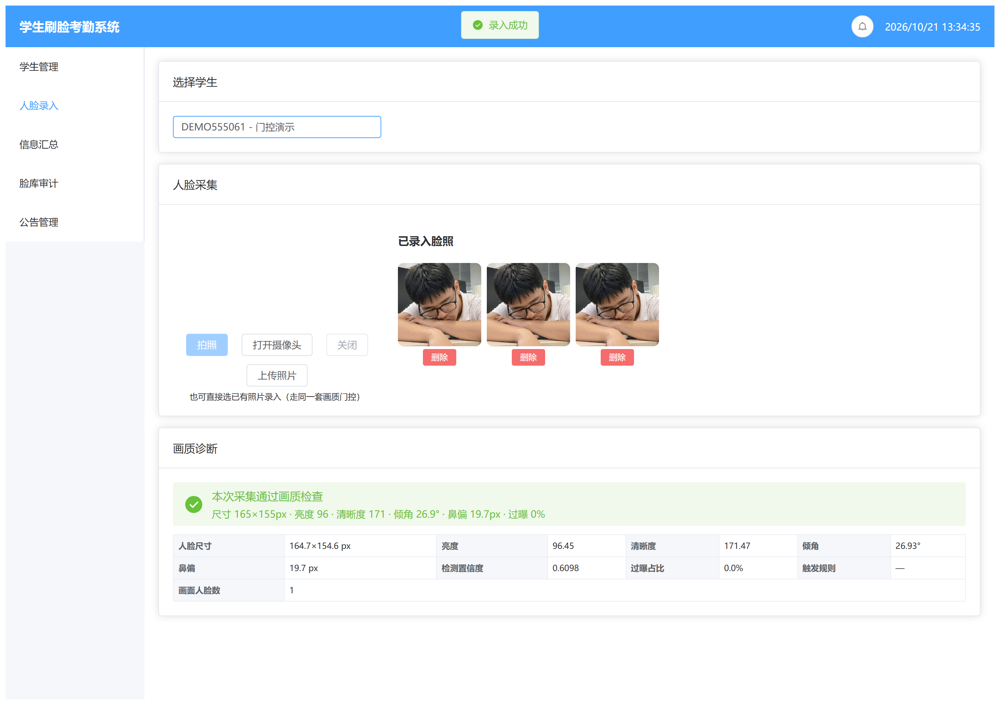

# 学生刷脸考勤系统

FastAPI + Vue 3 全栈实现，覆盖**六大模块**：
学生管理、人脸录入、**刷脸签到**、信息汇总、公告推送、**脸库审计**
（审计为双通道：跨学号两两比对 + 层次聚类，阈值经网格扫描与独立验证集标定为 0.40 / 0.60）。

> **一句话**：录入一道脸 512 维 ArcFace 特征 → SQLite 存业务元数据 + Milvus Lite 存向量 →
> 既能实时查重，又能用层次聚类离线审计出「一人多号 / 录错人」。
> 端到端 **68 项断言** + **25 项单元测试**全部通过（2026-10-26 实测：e2e 68/68，pytest 25 passed）。
> 原始输出已归档在 `docs/verify-log/`，核验命令与全部数字的出处见 **`docs/VERIFY.md`**
> （改任何数字前先看它——同一个数字散落在简历 / README / 论文 / 掘金文章 / Gitee 仓库简介五处）。

> **关于这份文档**：数值、阈值、断言数全部为实测值而非估计值，推送前逐项核过一遍；
> 求职前自查发现并修正的问题（含 LICENSE 署名误用他人、提交邮箱域名写错等 6 项）留档在文末
> **「十·补：已修正的疏漏（留档说明）」**，未做抹除式改写 —— 理由见该节。

> **要自己改这个项目？** 先看 **`docs/OWNER-GUIDE.md`**（自主维护手册：改代码改哪里、
> 怎么提交推送、**绿点为什么不亮怎么修**、出错了怎么回退、换电脑怎么重装）；
> 随时可以跑 `python scripts/doctor.py` 做一键体检（身份 / 同步 / 敏感信息 / 绿点）。

## 界面预览

| 学生管理 | 信息汇总 |
|---|---|
|  |  |
| 人脸录入 | 脸库审计（ML） |
|  |  |



**画质门控的拒绝提示（真实界面）** —— 拒绝时直接给出可执行动作，并列出实测指标：

| 太小（G1） | 多人（G2） | 过暗（G6） | 模糊（G7） | 合格通过 |
|---|---|---|---|---|
|  |  |  |  |  |

## 项目亮点（五条）

1. **三处存储的写入一致性与级联删除**：一次人脸录入要同时写磁盘原图、SQLite 元数据、Milvus 向量。
   这三个地方没有事务可用，**写入中途失败会留下「有图有记录但检索不到」的半截数据且不会自愈**，
   因此按「磁盘 → 关系库 → 向量库」顺序写入，成功一步压一步进 undo 栈，任一步失败即逆序补偿清理
   （回滚链中某一步失败不影响其余步骤；`face_status` 是派生字段，更新失败刻意不回滚，
   见 `service/face_service.py` 注释）。删除学生时三处级联回收（含孤儿脸照）。
   端到端用例 + 6 项回滚专项单测（`test/test_enroll_rollback.py`）已覆盖并在 Milvus Lite 上实测通过。
2. **阈值是实测标定的，不是抄来的**：网上资料常见的 0.8 阈值对已归一化的 ArcFace 向量**永远查不出问题**；
   本项目拉了真实的相似度矩阵，测出「同人 0.43~0.98 / 异人 -0.09~0.21」，
   再经网格扫描与独立验证集复核，最终部署 **cross_student=0.40 / cluster_distance=0.60**（详见第六节）。
   画质门控 7 条规则的阈值同样来自实测（详见第五·补二）。
3. **画质门控把脏数据挡在入口**：录进去一张糊图/侧脸/过曝照，后续识别天天失败且无法回溯原因。
   本项目在检测与入库之间加了 7 条规则的质量门控（尺寸/多人/置信度/侧倾/姿态/亮度/清晰度），
   拒绝时返回**可执行的**中文提示（"光照不足，请开灯"而不是"图片不合格"），脏图不落库。
4. **零外部服务依赖就能跑**：Milvus Lite 以本地文件形式提供向量检索（HNSW + COSINE），
   搭配 SQLite，整机不需要装任何数据库服务即可启动演示；另提供 `Dockerfile` +
   `docker-compose.yml`（见「三、启动方式」，注意尚未实机构建验证）。
5. **单文件数据库的并发写不是玄学，是被量出来的**：SQLite 出厂用 rollback journal，
   同一时刻只允许一个写事务。50 并发写实测 P95 **≈ 2.2 s**；开启 WAL + busy_timeout 后
   **≈ 0.28 s**（约 8 倍），写吞吐 190 → 420 TPS。关键是失败形态**不报错只涨延迟**，
   读压测永远发现不了（详见八·补·四）。

---

## 持续运行记录

> "能跑"和"在用"是两回事。这个项目配了每日自动任务，
> 每天早上 8:40 自动取数并记进 [`每日清单.md`](每日清单.md)，
> 仓库的提交历史即运行轨迹。

| 日期 | 已录入人数 | 向量数 | 新增录入 | 异常数 |
|---|---:|---:|---:|---:|
| 2026-10-21 | 7 | 12 | - | 0 |

> 首次运行尚无前一日基线，「新增录入」显示为 `-`，次日起自动计算。
> 上表是**节选**，完整历史见 [`每日清单.md`](每日清单.md)——那个文件是自动维护的，
> 这里只保留最近一条用于说明格式。
> 数据由 `backend/scripts/daily_run_stats.py --append` 自动写入，
> SQLite 与 Milvus 条数一致性每天校验，异常数来自脸库审计。

---

## 一、当前状态（已验证）

| 项目 | 状态 |
|------|------|
| 后端接口 | ✅ 已实现并通过端到端联调 **68 项断言**，另有 **25 项单元测试** |
| 人脸识别模型 | ✅ buffalo_l (ArcFace) 已下载并加载成功 |
| 向量库 | ✅ Milvus Lite 在 Windows 实测可用（HNSW + COSINE） |
| 前端 | ✅ `npm run build` 通过（2245 模块），dev server 可访问 |
| 演示数据 | ✅ 28 名学生，7 人已录入真实人脸（12 张照片 / 7 个身份） |
| 持续运行 | ✅ 每日自动取数已启用，记录见上方「持续运行记录」 |


联调结果示例：

```
[1] 健康检查 / 系统状态 / 枚举        PASS
[2] 学生 CRUD + 学号唯一 + 枚举校验    PASS
[3] 人脸录入 + 无脸拒收               PASS
[4] 汇总统计 / 覆盖率 / 脸照分布       PASS
[5] 脸库审计（ML 聚类）               PASS
[6] 公告 CRUD + WebSocket 实时推送     PASS
[7] 级联删除（SQLite+Milvus+磁盘）     PASS
[8] 真实人脸入库 + 聚类审计            PASS

结果：通过 68 项，失败 0 项

（上方为阶段一联调的示例输出；加入签到闭环阶段后断言增至 68 项，
另有 25 项单元测试走 pytest（见「八、验证与演示脚本」）。）
```

---

## 二、目录结构

```
face-attendance/
├── README.md                  本文件
├── RESUME.md                  简历素材与面试口径说明
├── LICENSE                    MIT
├── 每日清单.md                 每日自动取数记录（脚本维护）
│
├── scripts/                   运维脚本（与业务代码分离）
│   ├── start-backend.cmd      一键启动后端 (8000)
│   ├── start-frontend.cmd     一键启动前端 (5173)
│   ├── push-to-gitee.bat      交互式推送
│   ├── push-to-gitee-safe.bat 只推送、不改写历史
│   ├── push-to-gitee-auto.sh  无人值守推送（读 .gitee-token）
│   └── check-gitee-contrib.sh Gitee 贡献归属巡检
│
├── tools/                     一次性脚手架生成器（保留以复现工程结构）
│   ├── gen_backend.py         生成 FastAPI 后端目录骨架
│   └── gen_frontend.py        生成 Vue 前端目录骨架
│
├── docs/
│   ├── quiz.html              知识点考核（14 题交互式）
│   ├── blog/                  技术笔记
│   ├── audit-recall-report.md 脸库审计召回率评测报告
│   └── screenshots/           README 界面图
│
├── backend/
│   ├── main.py                入口：路由装配 + lifespan + 统一异常处理
│   ├── requirements.txt
│   ├── attendance.db          SQLite（运行时生成）
│   ├── milvus_lite.db/        Milvus Lite 数据目录（运行时生成）
│   ├── uploads/faces/<学号>/  人脸原图（运行时生成）
│   ├── core/                  ★ 基础设施层
│   │   ├── config.py          Settings（路径/端口/维度/模型名）
│   │   ├── db.py              SQLAlchemy engine + PRAGMA foreign_keys=ON
│   │   ├── milvus.py          向量库客户端 + 集合管理 + load 保证
│   │   ├── face_engine.py     insightface 单例 + 检测/取特征
│   │   ├── quality_gate.py    ★ 画质门控（7 条规则，阈值实测标定）
│   │   ├── face_types.py      FaceCandidate（门控与检测器解耦）
│   │   ├── enums.py           CSV 驱动的班级/专业枚举
│   │   ├── ws_manager.py      WebSocket 连接池（同步/异步双入口）
│   │   ├── response.py        统一响应包裹
│   │   └── exceptions.py
│   ├── models/                ORM 实体：student / face / notice
│   ├── schemas/               DTO：student / face / notice / common
│   ├── repository/            数据访问层：student_repo / face_repo / notice_repo
│   ├── service/               业务层
│   │   ├── student_service.py    CRUD + CSV 导入 + 三处级联删除
│   │   ├── face_service.py       录入流水线 + 画质门控 + 实时查重
│   │   ├── stats_service.py      汇总统计
│   │   ├── cluster_service.py    ★ ML 脸库审计（层次聚类）
│   │   └── notice_service.py     公告 + WS 广播
│   ├── api/                   控制层：students / faces / stats / audit / notices / system / deps
│   ├── data/                  班级.csv、专业.csv、示例学生导入.csv
│   └── scripts/
│       ├── download_model.py   下载 buffalo_l（多镜像并发择优）
│       ├── prepare_samples.py  裁切真实人脸样本（离线、零成本）
│       ├── seed_demo.py        种子数据
│       ├── e2e_test.py         端到端联调（68 项断言）
│       ├── calibrate_quality.py ★ 画质门控阈值标定（12 真实样本 + 8 类退化，可复现）
│       ├── audit_recall_test.py 脸库审计召回率评测（独立评测库，不动演示数据）
│       ├── daily_run_stats.py  每日真实运行取数 + SQLite/Milvus 条数一致性校验
│       ├── capture_ui.py       批量截图 README 用界面图
│       └── pii_guard.py        ★ 演示数据 PII 守卫（截图前必跑，防手机号进截图）
│
└── frontend/
    ├── vite.config.js         /api、/uploads、/ws 代理到 8000
    └── src/
        ├── api/               request(axios封装) / student / face / stats / audit / notice
        ├── components/        CameraCapture.vue（摄像头采集）
        ├── stores/            notice.js（pinia）
        ├── utils/             websocket.js（自动重连 + 补拉）
        └── views/             StudentList / FaceEnroll / StatsDashboard / FaceAudit / NoticeBoard
```

---

## 三、启动方式

### 首次准备（本机已完成，换机器才需要）

```bat
cd backend
python -m venv .venv
.venv\Scripts\python.exe -m pip install -r requirements.txt
.venv\Scripts\python.exe scripts\download_model.py
```

> `download_model.py` 会依次尝试 gh-proxy / ghfast / ghproxy / 官方源，自动挑最快的。
> 实测 gh-proxy.com 最快（约 30 秒下完 275MB）。

### 日常启动

```bat
scripts\start-backend.cmd
scripts\start-frontend.cmd
```

然后浏览器打开 **http://localhost:5173** ；接口文档在 **http://localhost:8000/docs** 。

**换机器 / 想让局域网内其他设备访问时**：

```bat
REM 后端默认只听 127.0.0.1；设置 APP_HOST 可放开监听
set APP_HOST=0.0.0.0
scripts\start-backend.cmd
```

> ⚠️ 放开监听前请注意：当前版本**没有做登录鉴权**，任何能访问到该端口的人都能读写全部接口。
> 仅在可信内网使用，或先自行补一层鉴权。
> 前端脚本不再硬编码 node 路径，只要求 `node` 在 PATH 里；找不到会给出明确提示而不是静默失败。

> ⚠️ **Milvus Lite 是单进程文件锁**：同一个 `backend/milvus_lite.db` 只能被一个进程打开。
> 若旧后端没退干净，新进程会报 `DataDirLockedError / Open local milvus failed`。
> 解决办法：`netstat -ano | findstr :8000` 找到 PID 后 `taskkill /F /PID <pid>`。
> 另外 `scripts/seed_demo.py` 需要先停掉后端再运行。

### Docker 启动（一条命令起后端）

```bash
docker compose up -d        # 首次会下载约 600MB 的人脸模型
docker compose logs -f api  # 看到 /api/health  healthcheck healthy 即就绪
```

打开 <http://localhost:8000/docs> 验证。停止：`docker compose down`
（`app-state` 卷保留 SQLite 与向量库，`insightface-models` 卷保留模型，重建不用重下）。

四个取舍写在 `Dockerfile` 注释里，这里只说结论：

1. **只容器化后端**。前端是 Vite 静态站，走 `npm run build` + nginx 是另一条链路，
   塞进同一镜像只会把关注点搅在一起。
2. **模型不烤进镜像**。buffalo_l 约 600MB，且不在 Git 仓库内；改为 entrypoint 首次启动下载 +
   `insightface-models` 命名卷缓存，重建容器不用重传。
3. **编译依赖用完即删**。`insightface` 在 PyPI 上是源码分发（含 Cython/C++ 扩展），
   slim 镜像没编译器，所以先装 `build-essential`，装完 `purge` 掉，避免工具链留在运行时层。
4. **数据卷按真实路径挂**。SQLite 与 Milvus-Lite 落在 `/app/backend/attendance.db`、
   `/app/backend/milvus_lite.db`（由 `core/config.py` 用 `BASE_DIR` 拼出），
   所以单独给了 `app-state` 卷并用 `SQLITE_URL` / `MILVUS_DB_PATH` 两个环境变量指过去
   （`config.py` 用 pydantic-settings，同名环境变量自动覆盖，无需改代码）。
   别挂在 `/app/backend/data`——那目录放的是启动加载的班级/专业 CSV 字典。

> ⚠️ **诚实标注：本机的开发环境没有安装 Docker，这个 Dockerfile 与 compose 文件
> 尚未实机 `docker build` 验证过。** 它按官方文档与依赖特性推演写成，
> 并用静查手段核过了：构建上下文体积、被引用的文件路径是否都存在、`/api/health` 是否真实存在、
> entrypoint 行尾是否为 LF、环境变量能否覆盖配置（原始输出见
> `docs/verify-log/docker_static_check_2026-10-26.txt`）。
> 首次构建如遇报错（最可能是 `insightface` 编译、`opencv-python` 缺 GL 库、
> 或模型源被墙），欢迎提 issue 或直接对照报错修正——请不要在没构建成功前对外声称"一键可用"。

---

## 四、接口一览

| 方法 | 路径 | 说明 |
|------|------|------|
| GET | `/api/health` | 存活探针 |
| GET | `/api/system/status` | 向量后端/向量数/模型加载/WS 在线数 |
| GET | `/api/enums` | 班级 + 专业枚举 |
| GET | `/api/students` | 分页 + keyword + class_name 筛选 |
| POST/PUT/DELETE | `/api/students[/{id}]` | 增改删（含学号唯一、枚举校验） |
| POST | `/api/students/import` | CSV/Excel 批量导入 |
| POST | `/api/students/{id}/faces` | 人脸录入（multipart，返回 detected + 实时查重结果） |
| GET | `/api/students/{id}/faces` | 该学生脸照列表 |
| DELETE | `/api/faces/{face_id}` | 删除单张脸照 |
| GET | `/api/stats/summary` | 总量 + 按班级/性别/专业分布 |
| GET | `/api/stats/face-coverage` | 录入覆盖率 |
| GET | `/api/stats/face-count` | 0/1/多张脸照人数分布 + 孤儿脸照数 |
| GET | `/api/audit/duplicates` | **脸库审计**（阈值可调） |
| GET | `/api/audit/similarity-matrix` | **相似度矩阵**（用于标定阈值） |
| GET/POST/PUT/DELETE | `/api/notices[/{id}]` | 公告 CRUD |
| WS | `/ws/notices` | 公告实时推送（支持 ping/pong 心跳） |

统一响应格式：`{"code": 0, "message": "ok", "data": {...}}`，`code != 0` 即为业务失败；
参数校验失败返回 `{"code": 422, "message": "<字段>: <原因>", "data": {...}}`。

---

## 五、人脸录入流水线

```
摄像头/文件上传
  → cv2.imdecode 解码
  → insightface buffalo_l 检测人脸（取面积最大的 1 张）
  → ★ 画质门控（7 条规则，见第五·补二）—— 不通过则拒绝入库，脏图不落盘
  → 512 维 ArcFace 特征（已 L2 归一化）
  → ① 原图落盘 uploads/faces/<学号>/<ts>.jpg
  → ② SQLite 写元数据（face_id = 自增 id，与向量库 1:1）
  → ③ Milvus 写向量（HNSW / COSINE）
  → ④ 向量检索查重：与库中已有脸比对，超过阈值即返回 duplicate_suspect
  → ⑤ 更新学生 face_status
```

未检出人脸时返回 `code=0 + detected=false + reason`，
被画质门控拒绝时返回 `code=0 + detected=true + enrolled=false + reason + rule + quality`，
两种情况前端都弹友好提示而不触发全局错误拦截。

### 五·补一：接口一览补充（画质相关）

| 接口 | 作用 |
|------|------|
| `POST /api/faces/preview` | 只做画质诊断，**不落库不写向量**，返回各项指标与触发规则（供外部调用方/联调自测） |
| `POST /api/students/{id}/faces` | 正式录入，被门控拒绝时返回 `enrolled=false` 及拒绝原因；通过时一并返回 `quality` 指标 |

### 五·补二：画质门控（7 条规则，阈值全部实测标定）

**为什么要有这道门**：录进去一张糊图/侧脸/过曝照，后续识别天天失败，
而且失败时无法回溯原因（库里只存了一张 jpg，谁知道当时拍成什么样）。
门控把脏数据挡在入口，而不是等到识别失败再回头猜。

| 规则 | 检查项 | 阈值 | 拒绝提示 |
|------|--------|------|----------|
| G1 | 人脸框尺寸 | 宽 ≥ 85px，高 ≥ 105px | 人脸太小，请靠近摄像头 |
| G2 | 画面多人 | 第二张脸面积 ≥ 主脸 30% | 画面中有 N 张人脸，请只保留一人 |
| G3 | 检测置信度 | ≥ 0.50 | 检测置信度不足，请重试 |
| G4 | 头部侧倾 | 双眼连线倾角 ≤ 35° | 检测到侧脸，请正对摄像头 |
| G5 | 面部姿态 | 鼻偏 ≤ 0.25 × 脸宽 | 面部姿态异常，请摆正 |
| G6 | 亮度 / 过曝 | 灰度 55~210，且纯白像素 ≤ 25% | 光照不足，请开灯 / 过曝，请背对光源 |
| G7 | 清晰度 | 归一化后拉普拉斯方差 ≥ 25 | 画面模糊，请稳住摄像头或擦净镜头 |

**三个设计要点**（都是实测踩出来的，不是照抄）：

1. **亮度规则必须排在清晰度之前。**
   光照不足会直接导致清晰度指标偏低，但它是更上游的原因。
   先报「画面模糊」，用户会去「稳住摄像头」，永远解决不了；
   先报「光照不足，请开灯」，换个环境就通过了。

2. **过曝用「纯白像素占比」判，不用亮度均值。**
   实测同一批图提亮 2.6 倍后，ROI 平均灰度只从 96 升到 193（看着不夸张），
   但纯白像素占比从 **0% 跳到 40%** —— 细节已经烧成纯白，不可逆丢失。
   烧白不可逆，均值升高却可能仍保留细节，所以必须用饱和度判。

3. **多人判定用「面积比」，不用「脸数量」。**
   本机样本里有背景带人脸的合影裁切（检出 2 张脸，但第二张只有主脸的 8%~17%），
   按「≥2 张脸就拒」会误杀 12 张合格素材中的 2 张。

**阈值怎么来的**：`backend/scripts/calibrate_quality.py` 可复现 ——
拿 12 张真实人脸 + 8 类人工退化（模糊/重度模糊/过暗/过曝/远距离小脸/侧倾/并排两人/背景小脸），
量出每项指标的分布，取「合格样本最劣值」与「退化样本最优值」之间作为阈值。
实测结论：**12 张合格样本 0 误伤，7 类退化（模糊/重度模糊/过暗/过曝/远距离小脸/侧倾/并排两人）12/12 全拦，背景小脸 0 误拦**。

**其它适配差异**（insightface 与参考实现 YuNet 不同，不能照抄）：
五点顺序相反（insightface 是 `[左眼,右眼,鼻尖,左嘴角,右嘴角]`，YuNet 是 `[右眼,左眼,...]`），
直接照抄倾角公式会算出 150~180°；本实现用 `abs(dx)/abs(dy)` 构角，天然对镜像不敏感。

**验证**：`backend/test/test_quality_gate.py`（1 个 pytest 用例，内含 19 项断言；不加载模型，秒级跑完），
端到端另有 10 项门控断言（含「脏图被拒后数据库里确实没多出这张脸照」）。

> 口径说明：README 里凡写「N 项单元测试」一律指 **pytest 用例数**（`pytest test/ -q` 的输出），
> 这里的「19 项断言」是单个用例内部的 assert 条数，两者不是同一口径，不要相加。

**门控实拍效果**：见文首「界面预览」的五张真实截图（太小 / 多人 / 过暗 / 模糊 / 合格通过）。
被拒时界面直接给出「请靠近摄像头 / 请只保留一人 / 请开灯 / 擦净镜头」这类可执行动作，
并把尺寸、亮度、清晰度、倾角、过曝占比等实测值一并列出，用户知道差在哪。

---

## 六、ML 实践：脸库审计

**思路**（非监督，无需标注）：

```
Milvus 拉全部向量 → L2 归一化 → N×N 余弦相似度矩阵
  → linkage(average, cosine distance) + fcluster 层次聚类
  → 三类异常：
       ① 同一学号内相似度 < 0.40        → 脏数据（可能录错人）
       ② 不同学号间相似度 > 0.50        → 疑似一人多号
       ③ 同一聚类簇内混入多个学号        → 强证据的重复注册
```

### 阈值是实测标定的，不是拍的

ArcFace `normed_embedding` 的余弦相似度实测分布（完整评测集，12 张素材 / 6 个身份）：

| 关系 | 相似度区间 |
|------|-----------|
| 同一人的不同照片 | **0.434 ~ 0.978** |
| 不同人 | **-0.09 ~ 0.212** |

所以判定边界落在 **0.4~0.5** 这个空档里。常见资料里写的 0.8+ 是针对未归一化向量或别的模型，
直接套用会导致**审计永远查不出任何问题**（本项目初版就踩了这个坑，实测矩阵才暴露出来）。

> **空档只解决"取哪一段"，不解决"取哪一点"。** 段内取值的最终结果是
> **cross_student=0.40 / cluster_distance=0.60**：由变量隔离的网格扫描筛出
> 「脏库零漏报 且 正常库零误报」的解集，再用独立验证集按双指标复核选出，
> 选点规则在运行前即写死。过程与数据见 `docs/blog/` 与脚本
> `audit_threshold_sweep.py` / `audit_validation_sweep.py`。

> 早期在小样本上量到的区间较窄（0.45~0.65），补齐评测集后上界拉高到 0.978 ——
> 同一个人在不同光照/角度下差异可以很大，这一点在补充样本时才暴露出来。
> 完整数据见第六·补一节与 `docs/blog/arcface-threshold-0.45.md`。

当前演示数据（3 张同一人照片误录到 3 个学号）的审计结果：

```json
{
  "cluster_count": 4,
  "duplicate_pairs": 3,
  "dirty_pairs": 0,
  "suspicious_cluster_count": 1,
  "students_involved": 3
}
```

调参方式（无需改代码）：

```
GET /api/audit/similarity-matrix              # 先看自己数据的真实分布
GET /api/audit/duplicates?cross_student=0.45  # 再定阈值
```

---

## 六·补：审计效果怎么验的（实测数据）

「能查重」这种话谁都会说，所以补了一个可复现的评测脚本：`backend/scripts/audit_recall_test.py`。

**它是怎么保证结论可信的：**

- 跑在**独立评测库** `backend/.eval/` 上（用环境变量改写 `SQLITE_URL` / `MILVUS_DB_PATH` / `FACE_IMG_DIR`），
  既不碰演示数据，也不和正在运行的后端抢 Milvus Lite 的单进程文件锁；
- 先用 ArcFace 特征把素材**自动聚成身份**（余弦相似度 > 0.45 判为同一人），再按
  **「一个身份只进一个组」** 造真值——否则两组里是同一个人，审计判他们重复其实是判对了，却被算成误报；
- 负样本入库前先校验两两相似度 < 0.40，确认彼此独立后才计入。

**实测结果**（完整报告见 `docs/audit-recall-report.md`）：

| 指标 | 结果 |
|---|---|
| 构造的异常组 | 4（1 组真实同人照片 + 3 组翻转／提亮增广） |
| 命中 | 4 |
| **召回率** | **100%** |
| 误报的跨组配对数 | 0 |
| 负样本（互不相干的人） | 3 个，被误报 0 个 |

组内相似度实测：**真实同人照片 0.565**、水平翻转增广 0.955、提亮增广 0.886
（真实同人照片落在第六节实测区间的下段，人工增广样本则接近上界）。

> 素材限制要如实说：本机可检出人脸的真实素材有限，同一人的多张照片只有 3 张可用，
> 其余身份来自 insightface 自带合影测试图。所以这是**小样本的正确性验证**，不是大规模基准测试。

### 六·补·二：对照组实验（不只报好结果）

只展示「脏数据能被查出」是不够的——**同一套审计代码跑在正常数据上如果也乱报，
那说明阈值太松、审计不可用**。所以演示库支持两种模式，用同一个脚本一键切换：

```bat
REM 正常录入：同一身份的多张照片归同一个学号
.venv\Scripts\python.exe scripts\seed_demo.py --drop --students 28 ^
    --faces-from scripts/sample_faces

REM 一人多号：故意把同一身份拆到不同学号（制造脏数据）
.venv\Scripts\python.exe scripts\seed_demo.py --drop --students 28 ^
    --faces-from scripts/sample_faces --split-identities
```

两种模式下的实测结果：

| 演示库状态 | 已录入 | 聚类簇数 | 跨学号重复 | 跨学生混合簇 |
|---|---:|---:|---:|---:|
| 正常录入 | 7/28 | 7（= 身份数） | **0** | **0** |
| 一人多号 | 12/28 | 7 | **14** | **1** |

**结论**：审计在正常数据上零误报，在脏数据上精准命中。
这比单看「脏数据被查出」有说服力得多——它同时证明了**不漏报**和**不误报**。

素材侧的实测数据也支持这个结论：
**同一人不同照片的相似度落在 0.434~0.978，而不同人之间的最大值只有 0.212**，
中间留出 0.22 的空档，阈值取 0.4 正好落在空档里（详见 `docs/blog/arcface-threshold-0.45.md`）。


## 七、技术栈

| 层 | 技术 |
|----|------|
| 后端框架 | FastAPI 0.136 + Uvicorn |
| ORM | SQLAlchemy 2.0（Mapped 声明式）+ SQLite（WAL + busy_timeout，见八·补·四） |
| 向量库 | Milvus Lite 2.5（HNSW + COSINE，512 维） |
| 人脸识别 | insightface 1.0.1 (buffalo_l / ArcFace) + onnxruntime |
| ML | numpy 相似度矩阵 + scipy 层次聚类 |
| 前端 | Vue 3.5 + Vite 6 + Element Plus + ECharts 5 + Pinia |
| 实时通信 | WebSocket（服务端连接池 + 前端断线重连） |
| 容器化 | Docker + docker-compose（仅后端；**尚未实机构建验证**） |

---

## 八、验证与演示脚本

```bat
cd backend

REM 端到端联调（需后端已启动）：68 项断言，覆盖全部接口与签到闭环
.venv\Scripts\python.exe scripts\e2e_test.py

REM 生成演示数据（需先停后端）：28 名学生 + 真实人脸录入（按身份分组）
.venv\Scripts\python.exe scripts\seed_demo.py --drop --students 28 ^
    --faces-from scripts/sample_faces --max-enroll 20

REM 重新生成真实人脸样本（离线，无需联网）
.venv\Scripts\python.exe scripts\prepare_samples.py

REM 每日真实运行取数：出今日入库/覆盖率/审计数据
.venv\Scripts\python.exe scripts\daily_run_stats.py

REM 同上，并把结果自动追加进「每日清单.md」（同一天只保留一行）
.venv\Scripts\python.exe scripts\daily_run_stats.py --append
```

> `daily_run_stats.py` 是给"持续运行"用的：项目**能跑**和**在用**是两回事，
> 简历上真正值钱的是后者，但它需要每天记数。这个脚本把取数压成一行命令，
> 顺带校验 SQLite 与 Milvus 条数是否一致（不一致即为孤儿数据），
> 并输出一行可直接粘进运营记录表的 markdown。
>
> **无需停后端**：脚本会自动判断后端是否在运行 ——
> 在跑就通过 HTTP 接口取数（绕开 Milvus Lite 的单进程文件锁），
> 没在跑就直连 SQLite + Milvus。两种模式结果一致。
>
> `--append` 会把当天结果写入项目根目录的 [`每日清单.md`](每日清单.md)，
> 同一天重复运行只保留一行，并按前一日向量数算出「新增录入」。
> 本项目已配置每日自动任务（早上 8:40 跑），记录会持续累积。

`scripts/sample_faces/` 内的样本由 `prepare_samples.py` 从 insightface 自带测试图
与本机已有图片裁切而来，**不依赖网络、不产生额外费用**。

### 画质门控的阈值是怎么定出来的

```bat
cd backend
.venv\Scripts\python.exe scripts\calibrate_quality.py
```

脚本会拿 12 张真实人脸 + 8 类人工退化样本（模糊 / 重度模糊 / 过暗 / 过曝 /
远距离小脸 / 侧倾 / 并排两人 / 背景小脸），逐项量出指标分布，
打印每个阈值的「合格侧 vs 退化侧」对比，最后跑一遍门控整体验证：

```
合格样本：通过 12 / 误伤 0
OK blur         应拦 → 拦住 12 / 漏放 0
OK blur_heavy   应拦 → 拦住 12 / 漏放 0
OK dark         应拦 → 拦住 12 / 漏放 0
OK overexpose   应拦 → 拦住 12 / 漏放 0
OK small        应拦 → 拦住 12 / 漏放 0
OK side         应拦 → 拦住 12 / 漏放 0
OK multi        应拦 → 拦住 12 / 漏放 0
OK bg_face      不应拦 → 放行 12 / 误拦 0
```

> `bg_face`（背景带一张小脸）专门用来验证**不误伤** ——
> 合影裁切出来的素材本来就带背景人脸，拦了就是错杀。

门控的单元测试不加载模型，秒级跑完：

```bat
cd backend
.venv\Scripts\python.exe test\test_quality_gate.py
```

### 八·补·三：阈值基线对照（默认阈值 vs 标定值）

脚本 **`backend/scripts/audit_baseline_compare.py`**（dirty / normal 各起一个进程）：

```bat
cd backend
.venv\Scripts\python.exe scripts\audit_baseline_compare.py --scenario dirty
.venv\Scripts\python.exe scripts\audit_baseline_compare.py --scenario normal
```

网格扫描回答的是「哪个档位最好」，但它不回答「**如果什么都不做会怎样**」。
`15 对全部检出` 是个绝对值，没有参照系——不知道这 15 是标定挣来的，还是数据本来就简单。
所以把常见默认阈值拉到同一份数据上跑一遍：

| cross_student | 脏库检出 | 正常库误报 | 说明 |
|---:|---:|---:|---|
| **0.80** | **1 / 15** | 0 | 网上资料对人脸识别最常见的推荐值 |
| 0.70 | 3 / 15 | 0 | |
| 0.60 | 9 / 15 | 0 | |
| 0.50 | 14 / 15 | 0 | 本项目初版写死的值 |
| 0.45 | 14 / 15 | 0 | |
| **0.40** | **15 / 15** | 0 | ★ 部署值 |
| 0.35 | 15 / 15 | 0 | |
| 0.30 | 15 / 15 | 0 | |

三点结论：

1. **常见默认阈值 0.80 在这份数据上基本等于关掉审计**——15 对重复注册只检出 1 对，漏 14 对。
   原因是 0.8 针对的是未归一化向量或别的模型，套到已归一化的 ArcFace 上永远越不过；
2. **正常库从 0.80 降到 0.30 全程零误报**，说明在这份数据上降阈值是"纯赚"，
   标定值不是拿误报换召回的妥协；
3. **0.40 是召回饱和点中最保守的一档**：0.40 / 0.35 / 0.30 都是 15 对，
   按"并列时取余量最大者"的规则选 0.40——离异人分布最远，最不容易被新数据推翻。

原始数据：`docs/verify-log/audit_baseline_dirty.json`、`docs/verify-log/audit_baseline_normal.json`。

### 八·补·二：接口压测（50 并发）

脚本位置 **`backend/scripts/bench_api.py`**（注意在 `backend/` 下，不是仓库根目录的 `scripts/`）：

```bat
cd backend
.venv\Scripts\python.exe scripts\bench_api.py --concurrency 50
```

压测刻意**分两组**，因为混在一起报"平均响应 xx ms"是自欺欺人 ——
平均数是被轻接口拉低的，而真正决定系统容量的是推理接口。

**A 组 · 纯业务接口**（无模型推理，瓶颈在 SQLite 与序列化）— 并发 50：

| 接口 | P50 | P95 | P99 | 错误 | 吞吐 |
|---|---:|---:|---:|---:|---:|
| `GET /api/health` | 8.1 ms | 11.9 ms | 13.8 ms | 0 | 1374 QPS |
| `GET /api/students`（分页） | 98.6 ms | 119.4 ms | 141.2 ms | 0 | 304 QPS |
| `GET /api/attendance/summary` | 41.6 ms | 58.9 ms | 59.2 ms | 0 | 633 QPS |

> **口径必须写清楚**（不写就是在误导）：
> - **读为主**：A 组三个接口全是 GET。写路径另测，见「八·补·四」。
> - **本机数据**：Intel i5-13500H（12 核 16 线程）/ 16 GB / Windows 11，服务与压测脚本同机。
>   同机压测会互相抢 CPU，真实部署下的数字应更好看而不是更差。
> - **数据量极小**：压测时库里只有 28 名学生、12 张人脸、3 条考勤（52 KB）。
>   这组数字反映的是**框架 + 序列化 + SQLite 小库查询**的开销，**不代表大数据量下的表现**；
>   量上去以后 `students` 分页会先退化（缺少覆盖查询条件的复合索引）。
> - 因此对外承诺的正确说法是「**本机、小数据量、读为主的业务接口，50 并发 P95 ≤ 120 ms**」，
>   三个限定语一个都不能少。

**B 组 · 含模型推理**（SCRFD 检测 + ArcFace 前向，瓶颈在 CPU）— 单机 CPU 推理：

| 接口 | 并发 1 | 并发 10 (P95) | 并发 50 |
|---|---:|---:|---|
| `POST /api/faces/preview` | 1547 ms | 18247 ms | 超时（>60 s） |
| `POST /api/attendance/checkin` | 1735 ms | 17131 ms | 超时（>60 s） |
| `GET /api/audit/duplicates` | 110 ms | 108.7 ms | 45008 ms |

**结论与口径**：

1. 业务接口在 50 并发下 **P95 ≤ 120 ms、零错误**。对外引用时必须带上三个限定语：
   **本机（i5-13500H）、小数据量（28 名学生）、读为主**，缺一个就是过度承诺。
2. 含推理的接口**单请求 1.5~1.7 s，实测容量约 0.65 QPS**。50 并发不是死锁，
   是排队：50 × 1.5 s = 75 s 超过了 60 s 的客户端超时 —— 请求在线程池里等着，
   不是框架崩了。定位依据是并发 1 的基线与并发 10 的梯度完全吻合。
3. 因此**本系统不适合高并发推理场景**，也不需要：单机演示形态下一个教室一个摄像头，
   并发需求 ≈ 1。真要扩容，方向是把推理拆到独立进程池 / 加队列削峰 / 换 GPU，
   而不是调 Web 框架参数。

> 只报 A 组属于选择性呈现 —— 两组差 500 倍，藏掉 B 组就等于没测。
> 原始数据随仓库留存：`backend/scripts/bench_result.json`（压测时自动覆盖）。

---

### 八·补·四：SQLite 并发写 —— 一个读压测永远暴露不出的问题

A 组压测全是读接口。**写路径是另一回事**：SQLite 出厂用 rollback journal，
同一时刻只允许一个写事务，写还会阻塞读。这个问题在读压测里完全不会浮现，
但它决定了签到高峰期的真实体感。

脚本 **`backend/scripts/bench_sqlite_write.py`**（不需要起后端，跑在临时库上）：

```bat
cd backend
.venv\Scripts\python.exe scripts\bench_sqlite_write.py --writers 50 --per-writer 10
```

用真实 ORM 模型（`Student` + `Attendance`）跑「查当日是否已签 → 插入 → 提交」这条实际写入路径，
50 并发 × 10 事务 = 500 次写。四组对照（同一台 i5-13500H）：

| # | journal_mode | 连接池 | 失败率 | P95 | 写吞吐 |
|---|---|---|---:|---:|---:|
| A | delete（出厂默认） | QueuePool | 0% | **2182 ~ 2265 ms** | 189 ~ 196 TPS |
| B | WAL + busy_timeout=5s | QueuePool | 0% | **279 ~ 287 ms** | 416 ~ 499 TPS |
| C | delete（出厂默认） | NullPool | 0% | 2733 ~ 2755 ms | 149 ~ 154 TPS |
| D | WAL + busy_timeout=5s | NullPool | 0%（偶发 1 次） | 988 ~ 1092 ms | 203 ~ 281 TPS |

（A/B 跑了两次取区间；C/D 是不复用连接的极端情形，用来观察连接池失效后的形态。）

**三条结论**：

1. **失败形态不是报错，是延迟暴涨。** 连接池把并发排队消化掉了，监控上看不到 5xx，
   只会看到 P95 难看 —— 这类问题最容易被忽略，因为它不报警。
   所以「SQLite 扛不扛得住」的答案不是"会不会崩"，而是"P95 会到几秒"。
2. **`PRAGMA journal_mode=WAL` 把 P95 从约 2.2 s 压到约 0.28 s（约 8 倍），写吞吐翻倍以上。**
   WAL 下读写不再互斥，允许「一写多读」。项目已在 `core/db.py` 的连接事件里开启。
3. **`busy_timeout=5000` 是给写路径加的退化保护**：出厂是 0，抢不到锁立刻抛
   `database is locked`；设了之后绝大多数冲突变成短暂等待而不是直接报错。
   配套 `synchronous=NORMAL` —— WAL 下已保证崩溃一致性，不必每次提交都 fsync。

> 顺带一个实测现象：D 组偶发一次 `attempt to write a readonly database`（复跑未复现），
> 怀疑是 Windows 临时目录上 WAL 辅助文件的瞬时访问冲突，与锁无关；如实记录，不做掩饰。

原始数据：`docs/verify-log/bench_sqlite_write.json`。

### 八·补·五：M5 人脸识别模块强化（有效人脸索引 + 诊断字段落库）

参考项目把"人脸识别"单列成 M5，并明确两条**硬门槛**。本项目原实现已具备识别闭环与"识别余量"判定，
但对照 M5 后补了两处真缺口：

**① 已失效 / 孤儿人脸不能参与 1:N 匹配（M5 硬门槛①，HIGH）**

删除学生、删除单张脸时，SQLite / Milvus / 磁盘三处是分别删的，任一步失败都会留下
"Milvus 里还有向量、但 SQLite 已无记录"的孤儿向量。原 `search_similar` 直接查全库，
若命中孤儿向量就会"已注销学生还能打卡"。

修复：以 SQLite 的 `faces LEFT JOIN students(face_status=1)` 为唯一真相源，维护一份进程内
`face_id` 集合（`face_repo._ACTIVE_FACE_IDS`）。`search_similar` 默认 `only_active=True`，
命中结果只保留在集合内的 face_id；录入成功 / 删除学生 / 删除单张脸时即时增删该集合，
应用启动时整体重建一次。不在 Milvus 层加 filter 字段，避免改动集合 schema 丢数据。

**② 诊断字段必须落库（M5 硬门槛②）**

原 `attendance` 只存了 top1 相似度。阈值标定（M6）复盘"为什么判错"时，没有第二名、
没有余量就无从下手。现 `attendance` 增加三列：

| 字段 | 含义 |
|---|---|
| `top2_similarity` | 第二名相似度（无论是否同一人），用于 top1−top2 紧挨度判断 |
| `margin` | top1 与"另一个人"最高相似度的差（识别余量），越小越可疑 |
| `ambiguous` | 本次是否判为"相似脸、需人工确认"（0/1） |

`checkin` 在落库时一并写入这三列；同时接口返回新增 `decision` 字段（`unrecognized` /
`ambiguous` / `recognized`），把三态判定显式化。存量库通过 `migrate_attendance_diagnostics()`
（`core/db.py`，启动钩子自动调用）以 `ALTER TABLE ... ADD COLUMN` 补齐，不碰已有数据。

**③ 识别余量必须在「排除 top1 学号」的前提下计算（2026-10-28 修复的真 bug）**

原实现 `_identify_margin(hits)` 在 `top_k=3` 的检索窗口里找"另一个人"。但同一学生常录多张底片，
top3 窗口会被**本人底片占满**，"另一个人"根本不在窗口内 → `margin` 恒为 `None` →
`ambiguous` 永远 `False` → **歧义检测在真实数据上静默失效**，恰恰发生在它最该生效的场景
（一人多号、长相相近）。

修复：改为在 Milvus 层用 `filter=student_id != top1.student_id` 排除 top1 所属学号后重新检索，
直接取异人最高相似度来算余量（`face_repo.search_similar(..., exclude_student_id=...)`）。
已实测验证 Milvus-Lite 支持 `!=` 过滤表达式。

真实推理实测对比（`backend/tools/demo_recognition.py`）：

| 场景 | 修复前 | 修复后 |
|---|---|---|
| 同一人录 6 张底片后签到 | `margin=None` | `margin=0.9541` |
| 一人多号（同图注册两个学号） | `decision=recognized`（**未检出**） | `decision=ambiguous`，`margin=0.0` |

测试：`backend/test/test_m5_recognition.py`（5 项）+ `backend/test/test_attendance_margin.py`（9 项），
含 active 索引过滤、诊断字段落库、ambiguous 三态判定、以及"本人底片占满窗口时余量仍要算得出"
的回归用例，全部 monkeypatch 掉模型与 Milvus，秒级跑完。

`CHECKIN_THRESHOLD=0.50`（比审计 cross_student=0.40 更保守，因误接受会直接写一条出勤记录、
代价高于查重漏报）与 `MARGIN_WARN=0.10` 维持不变；二者尚未像审计阈值那样做过网格标定，
列为 README 已知事项待办。

测试：`backend/test/test_m5_recognition.py`（5 项）+ `backend/test/test_attendance_margin.py`（9 项），
含 active 索引过滤、诊断字段落库、ambiguous 三态判定、以及"本人底片占满窗口时余量仍要算得出"
的回归用例，全部 monkeypatch 掉模型与 Milvus，秒级跑完。

---

## 八·补：技术笔记

- [ArcFace 相似度阈值别再抄 0.8 了：我用一次实测把它换成 0.4~0.5 的空档](docs/blog/arcface-threshold-0.45.md)
  —— 记录阈值从"抄资料"到"实测标定"的完整过程，含评测脚本设计与踩坑复盘
- [抄来的画质门控阈值，在我的模型上全是错的](docs/blog/quality-gate-threshold-calibration.md)
  —— 换检测模型后五点顺序反了导致倾角算成 180°、置信度对画质非单调、
  过曝该用纯白占比而非亮度均值；含完整标定数据与"如何证明不误伤"的方法

---

## 九、推送到 Gitee

```bat
push-to-gitee-safe.bat
```

只做 `push`，不改写任何 commit 历史。脚本会在推送前先 `fetch` 并检查
「本地落后远端多少」，落后则中止并提示，**任何情况下都不使用 force push**。

**需要准备**：Gitee → 设置 → 私人令牌 → 勾选 `projects` 权限 → 生成 token。
推送时用户名填 Gitee 账号名（不是邮箱），密码处粘贴 token（不是登录密码）。

### 无人值守推送（供每日自动任务使用）

```bash
bash push-to-gitee-auto.sh
```

交互式 `git push` 在定时任务里会静默挂死等输入，因此自动化场景改用这个脚本：

- 令牌从项目根目录的 `.gitee-token` 读取（**首行纯令牌文本**，该文件已被 `.gitignore` 忽略，不会入库）
- 推送前 `fetch` 检查 behind，落后即中止（不 force push）；ahead=0 直接跳过
- 推送后**自动恢复干净的 remote url 与 upstream**，令牌不写入 `.git/config`
- 输出中的令牌经脱敏处理

令牌轮换后只需更新 `.gitee-token` 一个文件，无需改脚本或改 git 配置。

> ⚠️ **不要用 `git commit --amend --reset-author` 修正作者**：Gitee 贡献图（绿点）
> 按 commit 的**作者邮箱 + 作者日期**统计，改写已推送提交会让绿点错位或消失。
> 正确做法见下节。

### 本项目的邮箱与绿点现状（2026-10-21 复核修正）

> ⚠️ **本节结论已于 2026-10-21 复核推翻并修正**：原先认为
> 「`users.noreply.gitee.com` 天然属于本账号、贡献图统计不受影响」不成立，实测如下。

| 作者邮箱 | 提交数 | 说明 |
|---|---:|---|
| `flowerjan10@users.noreply.gitee.com` | 28 | ⚠️ **域名写错了**，见下方说明 |
| 个人 QQ 邮箱（`2334****@qq.com`，已脱敏） | 2 | 早期提交，该邮箱已在「设置 → 多邮箱管理」完成验证 |

**绿点为什么不亮（实测结论）**

Gitee 贡献度按 commit 的【作者邮箱】统计，且该邮箱必须是账号在
「设置 → 多邮箱管理」里**已确认绑定/验证**的地址。

`flowerjan10@users.noreply.gitee.com` 里的 `users` 是**复数** —— 那是
**GitHub** 的隐私邮箱写法（GitHub 用 `users.noreply.github.com`）。
**Gitee 官方是单数 `user`，且带 `+用户名` 前缀**：

```
<数字用户ID>+flowerjan10@user.noreply.gitee.com
```

前缀的数字是 **Gitee 分配的数字用户 ID**，作用是让不同账号即使用户名部分相同、
生成的隐私邮箱也不冲突。

> ⚠️ **这个数字必须是你自己的用户 ID，否则提交会签到别人名下。**
> 实测踩过的坑：曾用 `12345+flowerjan10@user.noreply.gitee.com` 提交
> （`12345` 是文档里随手编的占位数字）。Gitee 按这个数字解析归属，
> 把它解析成了 **id=12345 对应的另一个账号**，提交页面署名的不是本人。
> **判断方法**：用 Gitee API 查提交详情，
> `author.id` 是不是你自己的用户 ID（本账号 = `17713492`）。
>
> ```bash
> curl -s "https://gitee.com/api/v5/repos/flowerjan10/face-attendance/commits/<sha>" \
>   | python -c "import json,sys;d=json.load(sys.stdin);print(d['author']['id'],d['author']['login'])"
> ```

Gitee 从未生成过 `users.noreply.gitee.com` 这个地址，账号里也不可能绑定它，
所以这 28 条提交**不计入贡献度**。

实测数据（2026-10-21 实测，非推测）：

| 检查项 | 接口 | 结果 |
|---|---|---|
| 提交归属 | `/api/v5/repos/.../contributors` | 30 条全部 `name=FlowerJan10` ✅ |
| 推送事件 | `/contribution_timeline?year=2026` | 20 条 push，`is_proper=True` ✅ |
| **贡献日历** | `/contribution_calendar?year=2026` | **全年仅 1 天亮（10-16，2 个贡献）** ❌ |

> ⚠️ 注意别被 contributors 接口骗了：它返回的 `name` 很可能只是 commit 元数据里
> 的作者名字符串，**不能证明邮箱已与账号绑定**。判断绿点只认贡献日历。

**修复方法**：

1. 确认你的 Gitee 数字用户 ID（就是 `https://gitee.com/flowerjan10` 个人主页
   头像 URL 里的那串数字，本账号为 `17713492`）
2. 设置本地身份：
   ```bash
   git config --global user.email "17713492+flowerjan10@user.noreply.gitee.com"
   git config --global user.name  "FlowerJan10"
   ```
3. 做一次新提交推上去，用上面的 API 确认 `author.id` 是 `17713492`
4. 等几分钟刷新个人主页，看绿点是否点亮

> 📌 **历史绿点补不回来。** Gitee 官方明确说明「以前提交过的代码贡献度暂不支持回溯」，
> 邮箱配对之前的那 28 条提交，绿点是永久缺失的 —— 只能靠今后的新提交累积。
> 这也是「不改写历史」的技术依据：改写也补不回来，反而会让已有记录错位。

> 本仓库已提供 `python scripts/doctor.py` 一键复现以上全部检查，
> 完整排查过程与操作手册见 **`docs/OWNER-GUIDE.md`**（第 1 章专门讲绿点修复）。

> 早期 2 个提交用了个人 QQ 邮箱，该邮箱已随 commit 元数据留在 Gitee 侧；
> 在不重写历史的前提下无法抹掉，故本仓库正文不再出现完整真实邮箱。

---

## 十、已知边界（当前版本未覆盖）

- 未做登录鉴权（需求文档未要求）
- 未做真实课堂考勤批次/课程表（属第二阶段）
- 摄像头采集依赖浏览器 `getUserMedia`，需 `localhost` 或 HTTPS 环境
- 向量规模为万级以内；更大规模建议换成独立部署的 Milvus 服务

### 十·补：已修正的疏漏（留档说明）

写在这里而不是删掉 git 历史，是因为**删历史要重写所有 commit**，
而 Gitee 贡献图（绿点）按 commit 的作者邮箱 + 作者日期统计，
重写会让绿点错位或消失（详见第九节）。所以选择留痕修正。

| # | 问题 | 发现时间 | 修正 | 现状 |
|---|---|---|---|---|
| 1 | **LICENSE 版权署名误用他人** | 2026-10-19 | 初始提交 `c474b11` 复制了参考实现的 LICENSE 模板，把参考来源作者的署名 `youjiazhijiayou` 一并带了进来；`d3a3481` 改回 `FlowerJan10` | 当前 HEAD 已正确；**旧 commit `c474b11` 的历史里仍可见这一行**（全历史仅此 1 处） |
| 2 | README 公开了真实 QQ 邮箱 | 2026-10-21 | 邮箱出现在「邮箱与绿点现状」表格里 —— 那段本意正是「不暴露真实邮箱」，自相矛盾 | 已脱敏为 `2334****@qq.com`；该邮箱已随早期 2 个 commit 的作者元数据留在 Gitee 侧 |
| 3 | 公开仓库曾出现带真实手机号的截图 | 2026-10-21 前 | 泄露载体是 PNG 的像素而非文本，`.text` 扫描查不出来；且演示库原本用 `13+随机数` 生成手机号，可能撞上真人号段 | 演示库改为 `1380000xxxx` 明显假号段、5 张界面图重新生成脱敏；新增 `scripts/pii_guard.py` 在**数据层**拦截（截图前先查库，非假号直接退出码 1），并让 `capture_ui.py` 强制先跑守卫，堵死复发路径 |
| 4 | 相似度区间前后矛盾 | 2026-10-21 | 同一份 README 里「同人 0.45~0.65」（早期小样本）与「0.434~0.978」（完整评测集）并存 | 统一为完整评测集数据，并加注说明区间为何随采样变宽 |
| 5 | 文档数字与实测不符 | 2026-10-21 | 行数写「约 7000 / 核心 3100」，实测是 3315 / 6415 | 已按 `git ls-files` 口径重新统计并校准 |
| 6 | **提交邮箱域名写错，导致 30 条提交全部未计入绿点** | 2026-10-21 | 一直用 `flowerjan10@users.noreply.gitee.com`（`users` 复数 —— 那是 **GitHub** 的写法）。Gitee 官方是**单数** `user.noreply.gitee.com` 且带 `+用户名` 前缀；这个地址 Gitee 从未生成过，账号里也不可能绑定 | README 第九节结论已推翻并改写为实测数据；`push-to-gitee-safe.bat` 不再硬编码邮箱，改为运行时询问；新增 `scripts/doctor.py`（一键自查）与 `docs/OWNER-GUIDE.md`（自主维护手册）。**需本人在 Gitee「多邮箱管理」页确认提交邮箱后改本地配置，新提交即可点亮** |

> 第 1 条性质上属于「把他人署名当成本人作品署名」，虽然对方是公开参考仓库的作者、
> 本项目也是独立重写，危害有限，但它确实是疏漏，如实记录在此。
> 第 6 条是**功能性缺陷**（不只是文档问题）—— 28 条提交因此没点亮绿点，
> 说明「提交成功 + 归属正确」不等于「贡献被统计」，这个坑值得单独记一笔。
> 其余各条均为求职前的自查修正，同样保留痕迹而非抹除。

---
