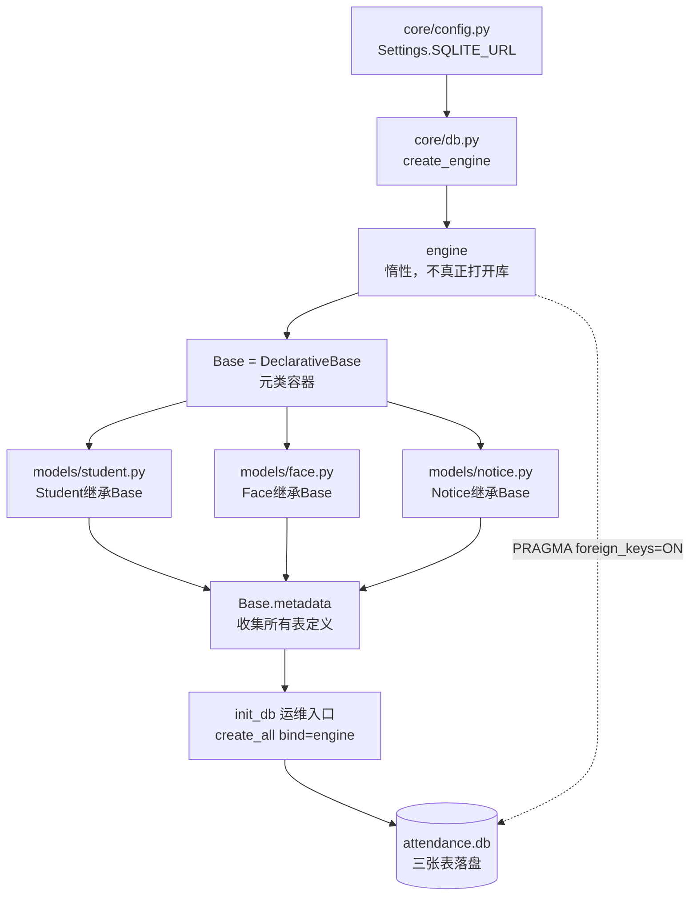
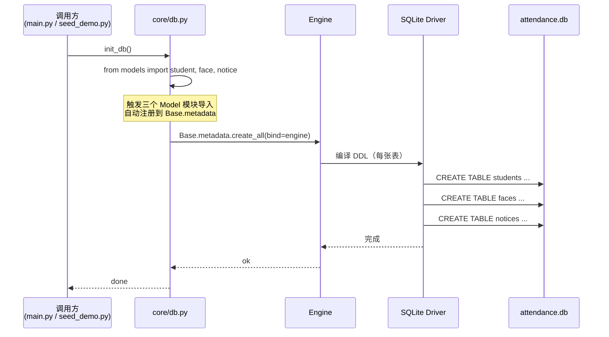

# 第一步：数据库初始化（基于 SQLAlchemy 2.x + SQLite）

> 本文档对应会议"第一步：数据库初始化与 Skill 封装"。
> 验证项目：`face-attendance/backend`。三张表：students / faces / notices。

## 一、目标

将 `backend/` 下的空 SQLite 文件（`attendance.db`）变成包含
**students / faces / notices** 三张真实表结构的数据库，
作为后续 Repository 层 CRUD 的地基。

完成态：从"零字节空文件" → "可被 ORM Session 增删改查的真实数据库"。

## 二、文件清单

| 路径 | 角色 | 关键内容 |
|------|------|----------|
| `core/config.py` | 配置 | `SQLITE_URL = sqlite:///<BASE_DIR>/attendance.db` |
| `core/db.py` | 基础设施 | `engine` / `SessionLocal` / `Base` / `get_db` / `init_db`（运维入口） |
| `models/student.py` | 实体 | `Student` ORM 类，映射 `students` 表 |
| `models/face.py` | 实体 | `Face` ORM 类，映射 `faces` 表，FK→`students.id` ON DELETE CASCADE |
| `models/notice.py` | 实体 | `Notice` ORM 类，映射 `notices` 表 |
| `attendance.db` | 数据 | SQLite 数据库文件，首次 `create_all` 时由 SQLite 驱动落盘 |

## 三、语法（关键 API 对照）

### 3.1 SQLAlchemy 2.x 声明式建表

```python
from sqlalchemy import create_engine
from sqlalchemy.orm import DeclarativeBase, Mapped, mapped_column

engine = create_engine("sqlite:///attendance.db", connect_args={"check_same_thread": False})

class Base(DeclarativeBase):
    pass

class Student(Base):
    __tablename__ = "students"   # 1:1：类名 ↔ 表名、属性 ↔ 列
    id: Mapped[int] = mapped_column(primary_key=True, autoincrement=True)
    student_no: Mapped[str] = mapped_column(String(20), unique=True, nullable=False, index=True)
    name: Mapped[str] = mapped_column(String(50), nullable=False)
    # ... 其余列同理
```

### 3.2 等价 SQL（DDL，对照参考）

```sql
CREATE TABLE students (
    id INTEGER PRIMARY KEY AUTOINCREMENT,
    student_no VARCHAR(20) UNIQUE NOT NULL,
    name VARCHAR(50) NOT NULL,
    gender VARCHAR(10),
    class_name VARCHAR(50),
    major VARCHAR(50),
    enroll_year INTEGER,
    phone VARCHAR(20),
    face_status INTEGER DEFAULT 0,
    created_at DATETIME DEFAULT CURRENT_TIMESTAMP,
    updated_at DATETIME DEFAULT CURRENT_TIMESTAMP
);

CREATE TABLE faces (
    id INTEGER PRIMARY KEY AUTOINCREMENT,
    face_id INTEGER UNIQUE NOT NULL,
    student_id INTEGER NOT NULL,
    image_path VARCHAR(255),
    created_at DATETIME DEFAULT CURRENT_TIMESTAMP,
    FOREIGN KEY (student_id) REFERENCES students(id) ON DELETE CASCADE
);

CREATE TABLE notices (
    id INTEGER PRIMARY KEY AUTOINCREMENT,
    title VARCHAR(100) NOT NULL,
    content TEXT,
    publisher VARCHAR(50),
    created_at DATETIME DEFAULT CURRENT_TIMESTAMP
);
```

## 四、流程图（从配置到建表的全链路）



## 五、时序图（init_db 调用链）



## 六、六视角总结

### 1. 认知视角 —— "从空文件到真实数据库"

> 把一个零字节的 `attendance.db`，变成里面真的有 `students / faces / notices` 三张表、可以用 SQL 查到结构的"活库"。
> 没建表前它就是一个普通文件；建表后它成为一个**有结构的持久化容器**。

### 2. 为什么视角 —— "SQLite 是文件型数据库，必须显式落地"

- SQLite 没有独立的服务进程（不像 MySQL/PG 那样常驻一个 server），
  库就是磁盘上的一个 `.db` 文件；
- 文件刚创建时是**空的**，没有任何表；
- 必须通过 DDL（`CREATE TABLE ...`）把表结构"种"进去，
  后续 ORM 的 CRUD 才有落点；
- 所以"建表"是 SQLite 项目的**第一步**，是不可跳过的地基动作。

### 3. 数据视角 —— "三张表的关键字、身份、关系"

| 表名 | 关键字（主键） | 身份（业务定位） | 关系连接方式 |
|------|---------------|------------------|-------------|
| `students` | `id` | 业务主实体：学生档案 | 被 `faces.student_id` 引用 |
| `faces` | `id`（业务键 `face_id` 唯一） | 脸照记录：连接 SQLite 与 Milvus | `student_id` 外键 → `students.id`，`ON DELETE CASCADE` |
| `notices` | `id` | 公告：独立无外键 | 不与上两张表关联 |

关系一句话：**students 是主，faces 是从（强外键 + 级联删除），notices 是旁观独立表。**

### 4. 迁移视角 —— "单文件服务器进程 vs 程序内七动作链"

对照传统数据库与 SQLite 的初始化差异：

| 维度 | MySQL/PG 等服务型库 | SQLite 文件型库（本项目） |
|------|---------------------|---------------------------|
| 服务器进程 | 常驻一个 server 进程 | **无**，库就是一个文件 |
| 建库 | DBA `CREATE DATABASE` | 创建空文件即"建库" |
| 建表 | DBA 写 DDL 脚本 | 程序内 `create_all` 或 DDL 脚本 |
| 连接 | TCP 到 server | `sqlite:///<path>` 直读文件 |

**程序内的"七动作链"**（指 SQLAlchemy 把建表落到磁盘的内部步骤）：

1. `create_engine(url)` —— 构造引擎（惰性，不真正连）
2. `event.listens_for(engine, "connect")` —— 注册 PRAGMA 钩子
3. `DeclarativeBase` 派生 `Base` —— 元类容器
4. `Mapped[...] + mapped_column(...)` —— 在 Model 类上声明列
5. **import models** —— 触发 Model 注册到 `Base.metadata`
6. `Base.metadata.create_all(bind=engine)` —— 编译 DDL 并下发
7. SQLite 驱动落盘到 `.db` 文件 —— 持久化完成

### 5. 程序视角 —— "Python 标准库 / SQLAlchemy 关键 API"

- **配置层**：`pydantic-settings.BaseSettings` 读 `SQLITE_URL`，统一从环境变量注入；
- **基础设施层**（`core/db.py`）：
  - `sqlalchemy.create_engine` —— 建引擎
  - `sqlalchemy.event.listens_for` —— 注册 connect 钩子（开外键）
  - `sqlalchemy.orm.sessionmaker` —— Session 工厂
  - `sqlalchemy.orm.DeclarativeBase` —— ORM 基类
- **Model 层**：
  - `sqlalchemy.orm.Mapped` + `mapped_column` —— 类型化声明列
  - `sqlalchemy.String/Integer/DateTime/func.now()` —— 列类型与默认值
- **建表入口**：`Base.metadata.create_all(bind=engine)` —— 一次性把 metadata 落地。

### 6. 新手小白视角 —— "地基打好后我站在哪"

想象一下：你刚拿到这个 backend 工程，**第一次让它跑起来**，
- 如果没有 `attendance.db`，或者库是空的，那么任何"添加学生"的接口都会报
  `no such table: students`；
- 跑了 `init_db()` 之后，库文件里有了三张表；
- 这时你写 `Student` ORM 类、`StudentRepository.create()` 才能真正写进去；
- **所以"建表"是地基**，地基打好之后，**Repository 的 CRUD 才有立足点**。

一句话总结：**地基决定上层能盖几层楼**。第一步不扎实，后面 ORM 写得再漂亮也只是空中楼阁。

## 七、复用说明（如何套到下一个项目）

把本步骤模板套到新项目时，**只改三个变量**：

1. **库名**：把 `attendance.db` 改成你的项目库（如 `library.db`）；
2. **三张表**：把 `students / faces / notices` 换成你项目的实体表；
3. **关系**：按业务重写外键（多对多要建中间表）。

其他基础设施代码（`engine / SessionLocal / Base / get_db / init_db` 的骨架）可原样复用。
