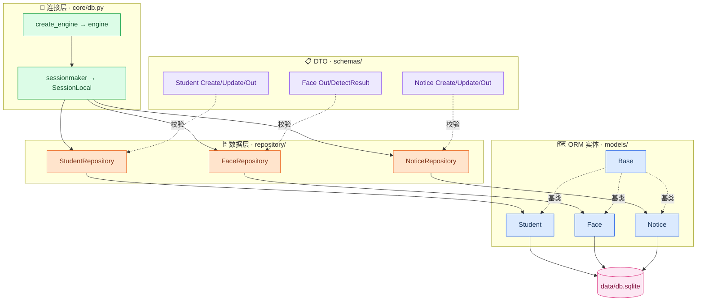
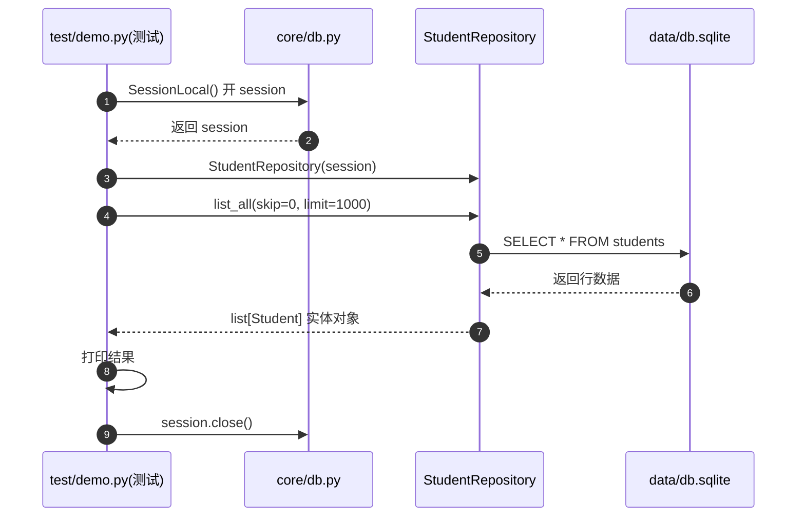

# 第二步：创建数据层

> 来源：Flower 起草的第二步总结文档（2026-09-21 会议延续）。
> 本文件原样存档，便于项目内追溯；可复用模板见 User 级 Skill `sqlalchemy-step2-data-layer`。

## 1. 这一步要干什么

用 SQLAlchemy ORM + pydantic 搭建「数据层」：定义 ORM 实体（models）、接口合同（schemas）、CRUD 数据访问（repository），并用 `core/db.py` 连接 `db.sqlite`。

一句话链路：**定义实体 → 定义 DTO → 写 CRUD → 连数据库**。

## 2. 这一步的目标

- 用 ORM 实体（`Mapped` + `mapped_column`）替代手写 SQL，映射 3 张表
- 用 pydantic DTO 定义接口合同，做输入校验、输出转换
- 用 Repository 封装 CRUD，session 构造注入
- 用 `core/db.py` 建立 engine + session 连接（不建表，建表归 `tools/init_db.py`）

## 3. 文件清单 · 库 · 语法

### 3.1 文件清单

| 文件 | 类型 | 作用 |
|------|------|------|
| `core/db.py` | 连接配置 | engine + sessionmaker + get_db，连接 db.sqlite |
| `models/base.py` | ORM 基类 | `Base(DeclarativeBase)`，实体统一基类 |
| `models/student.py` | ORM 实体 | students 表映射（11 字段） |
| `models/face.py` | ORM 实体 | faces 表映射（外键级联删除） |
| `models/notice.py` | ORM 实体 | notices 表映射 |
| `schemas/student.py` | DTO | 学生接口合同（Create/Update/Out） |
| `schemas/face.py` | DTO | 脸照接口合同（Out/DetectResult） |
| `schemas/notice.py` | DTO | 公告接口合同（Create/Update/Out） |
| `repository/student_repo.py` | 数据层 | 学生 CRUD |
| `repository/face_repo.py` | 数据层 | 脸照 CRUD |
| `repository/notice_repo.py` | 数据层 | 公告 CRUD |
| `data/班级.csv` `data/专业.csv` | 枚举数据源 | 班级/专业枚举值 |

### 3.2 库

| 库 | 版本 | 来源 | 用途 | 关键 API |
|----|------|------|------|---------|
| SQLAlchemy | 2.0.54 | 第三方 | ORM 映射 + 连接 | `DeclarativeBase` / `Mapped` / `mapped_column` / `ForeignKey` / `create_engine` / `sessionmaker` |
| pydantic | 2.13.5 | 第三方 | DTO 校验 + 转换 | `BaseModel` / `ConfigDict` |

### 3.3 语法

**SQLAlchemy 2.0 声明式映射：**

| 语法 | 说明 |
|------|------|
| `class Base(DeclarativeBase)` | 声明式基类（实体开关） |
| `class Student(Base)` + `__tablename__` | 实体映射表 |
| `id: Mapped[int] = mapped_column(Integer, primary_key=True)` | 列定义（元类拦截注册） |
| `ForeignKey("students.id", ondelete="CASCADE")` | 外键 + 级联删除 |

**pydantic v2：**

| 语法 | 说明 |
|------|------|
| `class StudentCreate(BaseModel)` | 定义 DTO |
| `ConfigDict(from_attributes=True)` | 允许从 ORM 对象直接转换 |
| `str \| None = None` | 可选字段（Python 3.10+ union） |

**Repository 模式：**

| 语法 | 说明 |
|------|------|
| `__init__(self, session)` | 构造注入 session（对应 @Autowired） |
| `session.scalars(select(...))` | 查询返回实体列表 |
| `add / flush / delete` | 增删（不 commit） |

**特性坑：**

1. SQLAlchemy 靠**元类**拦截 `mapped_column`，类定义那一刻就注册表结构，不是普通赋值
2. Repository **不 commit**，事务边界在 Service 层
3. **建表归 `tools/init_db.py`**（读 schema.sql），SQLAlchemy 不 `create_all`
4. `schema.sql` 与 `models` 是**两份表结构描述**，需人肉保持一致

## 4. 流程图

## 5. 时序图（测试用例如何走数据层）

## 6. 多视角总结

### A 视角 · 认知（是什么 → 为什么 → 怎么做）

- **是什么**：用 Python 类和对象，替代手写 SQL 操作数据库
- **为什么**：避免拼接 SQL 字符串，用对象思维操作数据，字段有类型、有校验
- **怎么做**：实体（models）描述表 → DTO（schemas）定义接口 → Repository 封装 CRUD → core/db 连接

### B 视角 · ORM 实体（类如何映射表）

| 实体类 | 继承 | 映射表 | 特殊点 |
|--------|------|--------|--------|
| `Base` | `DeclarativeBase` | — | 统一基类（开关） |
| `Student` | `Base` | students | 11 字段 |
| `Face` | `Base` | faces | `ForeignKey` 级联删除 |
| `Notice` | `Base` | notices | `Text` 大文本 |

### C 视角 · 复盘（交付 → 决策 → 坑 → 下一步）

- **交付**：models / schemas / repository 三包 + core/db.py + 两个枚举 CSV
- **关键决策**：删掉 `init_db()`，建表归 `tools/init_db.py`，SQLAlchemy 不碰 DDL
- **踩坑**：`from_attributes=True` 不加，DTO 无法从 ORM 对象转换；pydantic 漏装
- **下一步**：写测试用例验证 CRUD，再上 Service 层

### D 视角 · 迁移（SQLAlchemy vs JPA）

| 项 | SQLAlchemy | JPA (Java) |
|----|-----------|-----------|
| 实体定义 | `class` + `mapped_column` | `@Entity` + `@Column` |
| 建映射 | 元类拦截 | 注解 + 反射 |
| 会话 | `Session`（sessionmaker） | `EntityManager` |
| 连接 | `create_engine` | `DataSource` |
| 校验 | pydantic（独立 DTO） | Bean Validation |

### E 视角 · 程序（session → repository → 实体 → 库）

一条执行链：`SessionLocal()` 开 session → `StudentRepository(session)` 注入 → `list_all()` 发 `select` → SQLAlchemy 翻译成 SQL 执行 → 返回 `list[Student]` 实体对象 → 关闭 session。全程无手写 SQL。

### F 视角 · 新手小白（大白话）

models 是「仓库货架的图纸」，schemas 是「门口收发货的清单」，repository 是「搬货的工人」，core/db.py 是「仓库大门钥匙」。工人拿钥匙开门，照图纸找货架，按清单发货。

### G 视角 · 项目架构（这一步在全局的位置）

这一步补齐了需求文档三层架构（数据层 / 业务层 / 控制层）里的**数据层**：models + repository + core/db。schemas 是横跨数据层和控制层的「合同」。下一步往上走 service（业务层）、api（控制层）。
